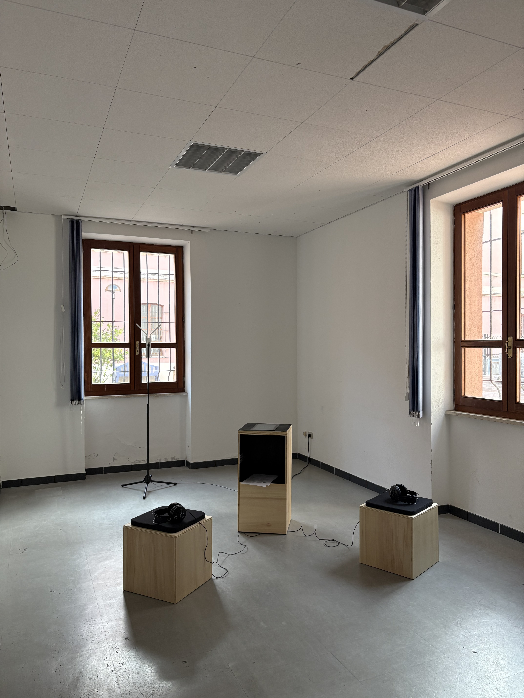

## Radio Concreta

Premio Nazionale delle Arti - XIX edizione
Sezione Interpretazione Musicale
Sottosezione “Musica Elettronica e Nuove Tecnologie”
Categoria D: Installazioni Sonore d’Arte
Sassari, 13-14 novembre 2025

### Radio Concreta is a sound installation that explores new forms of listening and transmission of audible signals through local wireless networks.

Throughout the 20th century, the spread of
radio and its technological development
contributed not only to the emergence of
electronic music but also to the process of
liberating sound from its context. Wireless
networks, which also fall under the
category of radio waves, have now
become an integral part of both public and
private spaces, in turn influencing the way
we listen to and perceive sound.

The installation is the result of an artistic
exploration of the potential of these
networks in the field of new music
technologies. The project began with the
design of a portable instrument, intended
for outdoor use, capable of sampling a
microphone signal and transmitting it to
other devices on the same network. Using
the console in the room, the user can
connect to the device and listen in real
time to the sound captured outdoors: the
result is a technological experience of the
urban soundscape—lo-fi by definition—
further accentuated by the precarious
nature of the transmission medium.

The repository contains source code, 3d models and data sheets.

Repository in progress, last update: 2025-11-13
